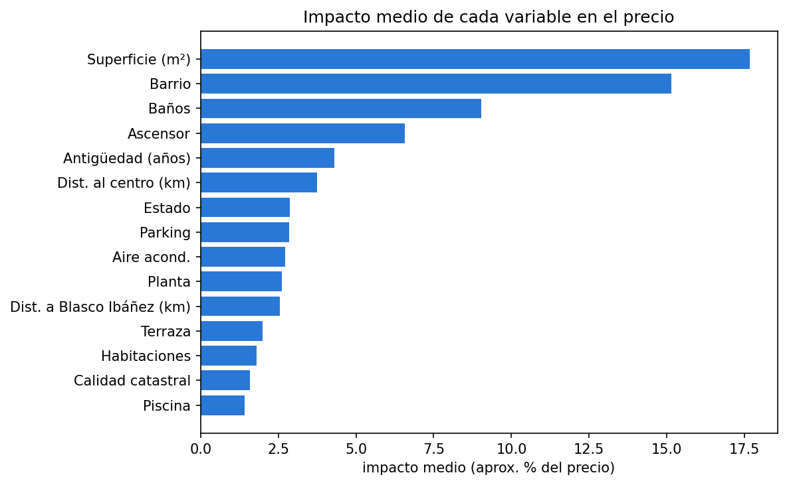
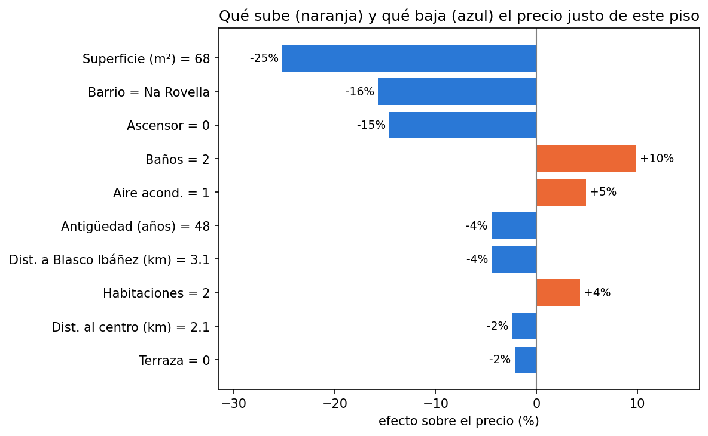

# ¿Chollo o timo? Detector de pisos mal tasados en Valencia

Modelo de *Machine Learning* que estima el **precio justo** de cada vivienda en venta a partir de sus características y su ubicación, y señala los anuncios cuyo precio se aleja mucho de esa estimación. Cada alerta viene con una **explicación** de qué sube y qué baja el precio de ese piso.

**Stack:** Python · pandas · scikit-learn · LightGBM · SHAP · matplotlib · Google Colab

---

## Resultados en 30 segundos

- **27.365 viviendas** analizadas en Valencia (anuncios reales de idealista, 2018).
- El modelo se equivoca un **13,5%** en un piso típico, frente al **19,3%** de la regla "metros × €/m² del barrio": **un 30% menos de error**.
- **2.073 anuncios marcados para revisión (7,6%)**: 1.115 anunciados muy por encima de su precio justo y 958 muy por debajo.
- A diferencia de un detector simple por barrio, el modelo **no confunde un piso a reformar o de obra nueva con uno mal tasado**.

---

## El problema

Un piso que cuesta mucho más o mucho menos que los de su barrio no está necesariamente mal tasado: puede ser de obra nueva, tener piscina o estar para reformar. La pregunta útil no es "¿es distinto de su barrio?", sino:

> **¿Cuánto debería costar este piso teniendo en cuenta todo lo que sabemos de él?**

Si el precio anunciado se aleja mucho de esa cifra, el anuncio merece una revisión: puede ser un chollo, un precio inflado o un error en los datos.

## Los datos

Paquete público [`idealista18`](https://github.com/paezha/idealista18) (Rey-Blanco, Arbués, López y Páez), con anuncios reales de venta de vivienda de idealista en 2018, enriquecidos con datos del Catastro.

- **Valencia:** 33.622 anuncios, 41 variables y 73 barrios.
- **Variables:** precio, superficie, habitaciones, baños, extras (ascensor, terraza, parking, piscina, portero…), estado, antigüedad y calidad del edificio, coordenadas y distancias al centro, al metro y a la Av. Blasco Ibáñez.

Se eligió un dataset público y documentado en lugar de hacer *scraping* de portales inmobiliarios, cuyas condiciones de uso lo prohíben.

---

## Metodología

### 1. Limpieza: [`01_exploracion_y_limpieza.ipynb`](notebooks/01_exploracion_y_limpieza.ipynb)

- **Duplicados:** el mismo piso aparece en varios trimestres (33.622 anuncios, pero 27.391 pisos distintos). Se conserva la última versión de cada uno para evitar **fuga de datos** entre entrenamiento y prueba.
- **Limpieza conservadora:** solo se eliminan 26 anuncios con valores físicamente imposibles (superficie fuera de 20–600 m², más de 10 habitaciones o más de 6 baños). **Los precios extremos no se eliminan**, porque son precisamente lo que el detector debe encontrar.
- **Barrio de cada piso:** se cruzan las coordenadas con los polígonos de los 73 barrios.

### 2. Exploración

- **La ubicación domina:** el barrio más caro (El Pla del Remei, ~3.360 €/m²) cuesta **más de 4 veces** por m² que el más barato.
- El precio tiene una distribución muy asimétrica, así que el modelo predice **log(precio)**: los errores son relativos y pesan igual en un piso de 100.000 € que en uno de 1 millón.
- Los extras asociados a más €/m² en una comparación directa son el **portero, el ascensor y la piscina**.

### 3. Un detector ingenuo y por qué falla

Primera idea: marcar los pisos cuyo €/m² es más del doble o menos de la mitad de la mediana de su barrio.

| Pisos marcados | % a reformar | % obra nueva |
|---|---|---|
| "Baratos" | **30,0** | 0,2 |
| "Caros" | 1,9 | **12,0** |
| Normales | 12,8 | 3,1 |

Los "baratos" tienen más del doble de pisos a reformar y los "caros" casi cuatro veces más obra nueva. El detector confunde **"distinto"** con **"mal tasado"**.

### 4. Modelo de precio justo: [`02_modelo_precio_justo.ipynb`](notebooks/02_modelo_precio_justo.ipynb)

- **32 variables:** tamaño, extras, estado, edificio y ubicación (incluido el barrio como variable categórica).
- **Validación espacial:** la ciudad se divide en una cuadrícula de ~500 m y cada cuadrado va entero a entrenamiento o a prueba (183 cuadrados; 21.686 pisos para entrenar y 5.679 para probar). Así, pisos del mismo edificio no acaban a ambos lados, algo que inflaría la precisión.
- **Modelo:** LightGBM, que capta relaciones no lineales, admite variables categóricas y gestiona los nulos sin necesidad de imputarlos.

| Modelo | Error mediano | Pisos con error < 10% |
|---|---|---|
| Referencia: m² × €/m² del barrio | 19,3% | 27,9% |
| **LightGBM** | **13,5%** | **38,9%** |

### 5. Detector

Cada piso recibe un precio justo calculado por un modelo que **nunca lo ha visto** (validación cruzada de 5 grupos respetando la cuadrícula). Se marca como:

- **Caro:** precio anunciado > 1,5 × precio justo (+50%).
- **Barato:** precio anunciado < 2/3 del precio justo (−33%).

(umbrales simétricos en escala logarítmica)

| Resultado | Anuncios | % |
|---|---|---|
| Normal | 25.292 | 92,4% |
| Caro | 1.115 | 4,1% |
| Barato | 958 | 3,5% |

**El modelo ya no se deja engañar por el estado del piso:**

| Pisos marcados | % a reformar | % obra nueva |
|---|---|---|
| "Baratos" | **15,6** (antes 30,0) | 2,0 |
| "Caros" | 10,9 | **2,6** (antes 12,0) |
| Normales | 12,9 | 3,3 |

Los pisos marcados tienen ahora casi la misma mezcla de estados que el resto: las alertas responden al **precio**, no a características que lo justifican.

### 6. Explicabilidad con SHAP

**¿Qué pesa más en el precio?**



- **Superficie (~17%)** y **barrio (~15%)** explican la mayor parte del precio.
- Los **baños (~9%)** pesan mucho más que las habitaciones (~2%): conocidos los metros, una habitación más apenas aporta información, mientras que un baño extra indica un piso de más categoría.
- El **ascensor (~6,5%)** es el extra más valioso.
- **Correlación no es causalidad:** el portero y la piscina, que en la exploración parecían los extras más valiosos, apenas influyen en el modelo. Su efecto aparente se debía a que suelen estar en pisos grandes y en buenos barrios.

**¿Por qué este piso tiene este precio justo?**



Piso en Na Rovella de 68 m², 2 habitaciones y en buen estado. Partiendo del precio típico de la ciudad (~156.000 €), el modelo lo rebaja por su tamaño (−25%), su barrio (−16%) y la falta de ascensor (−15%), y lo sube por tener 2 baños (+10%) y aire acondicionado (+5%). **Precio justo: ~81.000 €. Precio anunciado: 120.000 € (+48%).**

---

## Qué se encuentra en los casos extremos

- Los anuncios más **"caros"** están en barrios económicos (Patraix, Tres Forques, Torrefiel) con precios por m² propios del centro.
- Los más **"baratos"** están en los barrios más caros (Sant Francesc, El Pla del Remei, Penya-Roja) a precios por m² imposibles para la zona (por ejemplo, 75 m² en el Pla del Remei por 40.000 €).

Probablemente no son chollos ni sobreprecios, sino **anuncios anómalos**: errores de carga (metros, tipo de inmueble o ubicación) o ventas especiales que el dataset no distingue (nuda propiedad, viviendas ocupadas, subastas, ventas parciales).

**Conclusión:** el detector es más útil como **herramienta de revisión** (una lista priorizada de anuncios que una persona debería comprobar) que como juez automático. Los casos con desviaciones moderadas son los mejores candidatos a pisos realmente mal tasados.

---

## Limitaciones

- Son **precios anunciados**, no precios de venta finales.
- Los datos son de **2018**: el modelo describe ese mercado, no el actual.
- El dataset no incluye la **descripción del anuncio** ni fotos, que permitirían identificar nudas propiedades, viviendas ocupadas o pisos reformados.

## Próximos pasos

- **NLP sobre la descripción** del anuncio para detectar ventas especiales y filtrar falsos positivos.
- **Intervalos de predicción** (regresión cuantílica) para ajustar el umbral de alerta a la incertidumbre de cada piso.
- **App interactiva** (Streamlit) con un mapa: hacer clic en un piso y ver su precio justo y su explicación.
- Extender a **Madrid y Barcelona** (incluidas en el mismo dataset).

---

## Cómo ejecutarlo

Los notebooks están pensados para **Google Colab**:

1. Abrir `notebooks/01_exploracion_y_limpieza.ipynb` en Colab y ejecutarlo. Descarga los datos del repositorio público, los limpia y guarda `valencia_limpio.csv` en Google Drive (`MyDrive/detector-pisos/`).
2. Abrir `notebooks/02_modelo_precio_justo.ipynb` y ejecutarlo. Entrena el modelo, genera las alertas y guarda `valencia_resultados.csv` y el modelo en la misma carpeta.

En local: `pip install -r requirements.txt` (hay que adaptar las rutas de Google Drive).

```
├── notebooks/
│   ├── 01_exploracion_y_limpieza.ipynb
│   └── 02_modelo_precio_justo.ipynb
├── shap_global.png        # gráficos del README
├── shap_piso.png
├── requirements.txt
└── README.md
```

---

**Autor:** Fernando Amalfitano · Bootcamp de Big Data, Inteligencia Artificial y Machine Learning
[LinkedIn](https://www.linkedin.com/in/fernando-amalfitano-051751388/) · [Email](fernandoamalfitano@gmail.com)
